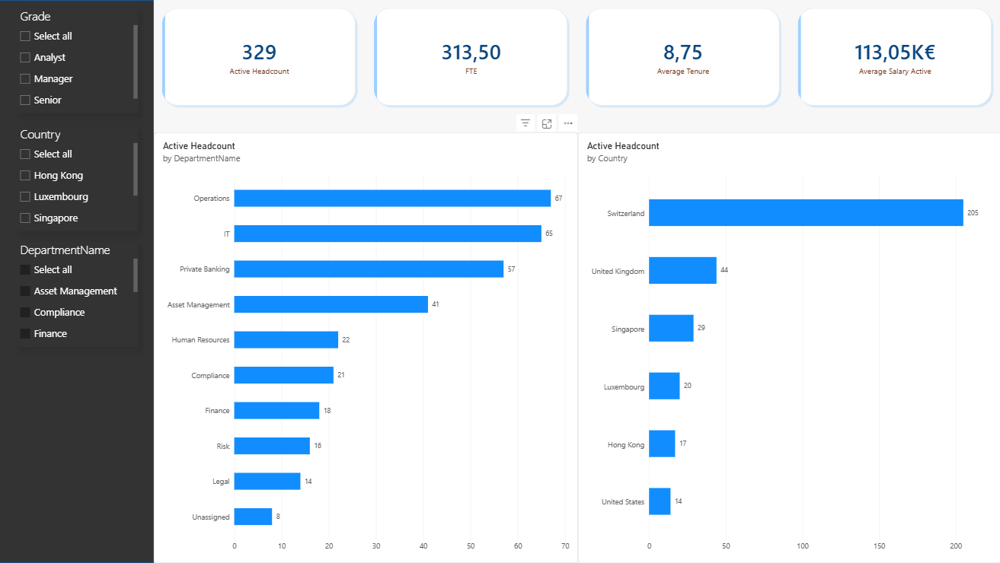
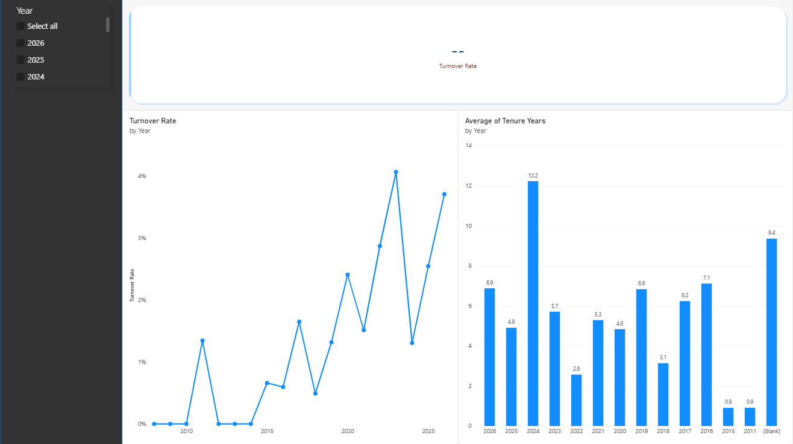
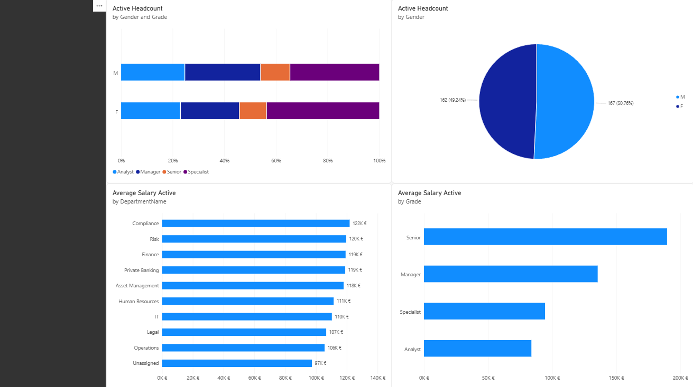
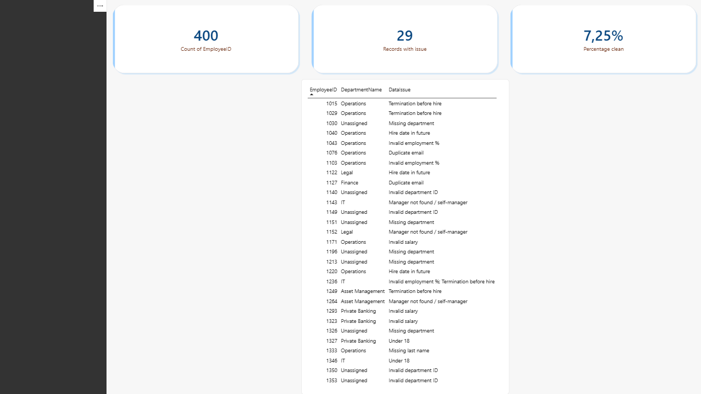

# HR Analytics: SQL Server & Power BI

An end-to-end HR analytics project built on a **synthetic** employee dataset. It covers the full workflow of a People Analytics team: loading raw data into SQL Server, detecting data-quality problems, producing a clean and flagged data layer, calculating HR KPIs, and presenting them in a Power BI dashboard.

> **All data is fictional.** No real employee or company data is used.

## Table of Contents

1. [Project Overview](#project-overview)
2. [Technologies Used](#technologies-used)
3. [Project Structure](#project-structure)
4. [SQL Analysis](#sql-analysis)
5. [Power BI Dashboard](#power-bi-dashboard)
6. [Screenshots](#screenshots)
7. [Key Skills Demonstrated](#key-skills-demonstrated)
8. [How to Reproduce](#how-to-reproduce)

---

## Project Overview

**Goal:** build a reliable HR reporting solution from imperfect source data, and show how the numbers were validated.

The dataset was designed to look like a real HR extract, including **deliberately planted errors** (duplicate employees, invalid departments, impossible dates, invalid salaries and others). This makes data quality part of the project, not an afterthought.

The project answers typical HR questions:

- How many active employees do we have, and where (department, country)?
- What is the FTE, average tenure and average salary?
- How many people leave each year, and what is the turnover rate?
- How is gender distributed across grades?
- Which records have data-quality issues, and which KPIs are affected?

**Guiding principle:** the raw data is never modified. Safe, unambiguous fixes are applied to a copy. Anything only HR can confirm (missing department, invalid salary, inconsistent dates) is **flagged and reported, not guessed**, and is excluded only from the calculations it would distort.

### Dataset (synthetic)

| Table | Content |
|---|---|
| `employees` | Employee records: dates, department, location, manager, grade, employment %, salary, email |
| `departments` | Department lookup |
| `locations` | City and country lookup |
| `salary_history` | Salary changes over time |

---

## Technologies Used

| Tool | Used for |
|---|---|
| **SQL Server (Express)** | Hosting the raw tables, cleaned table and views |
| **SSMS** | Importing the CSV files, writing and running T-SQL |
| **T-SQL** | Joins, aggregations, CTEs, window functions (`ROW_NUMBER`, `OVER`), `CASE WHEN`, views |
| **Excel (online)** | Initial exploration, pivot tables, manual error detection, comparing results against SQL, change log |
| **Power BI Desktop** | Data model, KPI measures, dashboard |
| **DAX** | Measures for headcount, FTE, tenure, salary and turnover |
| **Power Query** | Light data shaping on load (data types, naming), this part wasn't used, since the data was prepared in sql before adding it to power bi|
| **Git / GitHub** | Version control and portfolio |

---

## Project Structure

```
hr-analytics-sqlserver-powerbi/
├── README.md
├── data/
│   ├── employees.csv
│   ├── departments.csv
│   ├── locations.csv
│   └── salary_history.csv
├── sql/
│   ├── 01_exploration.sql
│   ├── 02_data_quality_checks.sql
│   ├── 03_clean_data.sql
│   └── 04_kpis.sql
├── excel/
│   └── dataset.xlsx
│   └── dataset-fixed.xlsx
└── powerbi/
    ├── hr_dashboard.pbix
    └── screenshots/
```

| Path | Purpose |
|---|---|
| `data/` | Synthetic raw CSV files, including the planted errors |
| `sql/01_exploration.sql` | Row counts, duplicate check, headcount by department, city and country, and reconciliation checks |
| `sql/02_data_quality_checks.sql` | One detection query per problem type, plus a summary query |
| `sql/03_clean_data.sql` | Builds `employees_clean` and the views `vw_employees_clean` and `vw_salary_history_clean` |
| `sql/04_kpis.sql` | HR KPI queries read from the clean view |
| `excel/` | Pivot tables, manual error detection and change log |
| `powerbi/` | Power BI report and dashboard screenshots |

### Data flow

```
Raw CSVs → SQL Server (raw tables) → Explore → Detect issues → Clean + flag → KPI queries
                                                                   │
                                                                   └→ Power BI (model + DAX measures + visuals)
```

---

## SQL Analysis

### 1. Exploration (`01_exploration.sql`)

- Row counts after import, and `COUNT(*)` vs `COUNT(DISTINCT EmployeeID)` to reveal duplicates.
- Headcount by department (with a `LEFT JOIN`, so employees with a missing or invalid department are not silently lost), by city and by country.
- Reconciliation checks: each breakdown must add up to the expected total.

### 2. Data-quality checks (`02_data_quality_checks.sql`)

Detection only. Nothing is changed. Each check is a separate query, and a summary query returns one row per issue type.

| Check | Example logic |
|---|---|
| Duplicate employees | `GROUP BY EmployeeID HAVING COUNT(*) > 1` |
| Duplicate emails across different employees | `COUNT(DISTINCT EmployeeID)` per email |
| Missing or invalid department | `LEFT JOIN` + `IS NULL` |
| Invalid manager link / self-manager | self-join on `ManagerID` |
| Termination before hire / hire date in the future | date comparisons |
| Invalid salary (≤ 0 or implausibly high) | range rule |
| Invalid employment percentage | range rule |
| Implausible birth date (under 18) | exact-age comparison |
| Missing names, name formatting | `LTRIM/RTRIM`, case-sensitive collation |
| Inconsistent gender coding | case-sensitive comparison against `'M'` / `'F'` |
| Orphan rows in `salary_history` | `LEFT JOIN` + `IS NULL` |

> Thresholds (for example salary above 500,000 or employment % outside 10–100) are **project assumptions**. In a real setting the valid ranges would be confirmed by the HR.

### 3. Cleaning (`03_clean_data.sql`)

- `employees_clean`: a copy of the raw table with **only safe fixes**: duplicate rows removed (`ROW_NUMBER() OVER (PARTITION BY ...)`), gender standardised, spaces trimmed, last-name capitalisation fixed.
- `vw_employees_clean`: adds validity flags (for example `IsValidSalary`, `IsValidDates`), a `DepartmentName` that shows `Unassigned` for missing or invalid departments, and a `DataIssue` text column. **No problem row is deleted and no uncertain value is changed.**
- `vw_salary_history_clean`: excludes salary rows whose employee does not exist.

### 4. KPIs (`04_kpis.sql`)

| KPI | Notes |
|---|---|
| Headcount by department | Active employees only |
| FTE by department | Sum of employment % / 100, invalid percentages excluded |
| Employees who left per year | Valid dates only |
| Turnover rate per year | Terminations / average headcount, using a recursive CTE for the year series |
| Average tenure | Active vs. employees who left |
| Gender split by grade | Counts and percentage within each grade |
| Average salary by department and grade | Valid salaries and active employees only |
| Salary outliers | Z-score within each grade using window functions (SQL only, not in the dashboard) |


---

## Power BI Dashboard

The report connects to SQL Server in **Import** mode and loads the clean views together with the department and location tables, linked by relationships. KPIs are implemented as **DAX measures**, so they respond to slicers. SQL results were used as the reference to validate the measures.

---

## Screenshots

### Overview



### Turnover and Tenure



### Diversity and Compensation



### Data Quality



---

## Key Skills Demonstrated

| Area | Skills |
|---|---|
| **SQL (T-SQL)** | Joins (inner and left), aggregation, `HAVING`, CTEs including a recursive CTE, window functions, `CASE WHEN`, views, date functions |
| **Data cleaning and data quality** | Detecting duplicates, orphans, impossible dates and invalid values; separating safe fixes from issues that need the data owner; keeping raw data intact; flagging instead of guessing |
| **Data validation** | Reconciling totals, cross-checking SQL results against Excel pivot tables and Power BI measures |
| **Data modelling** | Fact and dimension tables, one-to-many relationships in Power BI |
| **DAX** | Measures with `CALCULATE`, filter context, `DIVIDE`, variables |
| **Visualisation** | KPI cards, sorted bar charts, slicers, dashboard layout |
| **Excel** | Pivot tables, lookups, filters, data checks |
| **Confidentiality awareness** | Synthetic data only; salary shown as aggregates; employee-level detail treated as restricted |

---

## How to Reproduce

1. Create a database named `hr-data` in SQL Server.
2. Import the four CSV files from `data/` as tables (SSMS: *Tasks → Import Flat File*, allowing NULLs where values are blank).
3. Run the scripts in `sql/` in order (`02` to `05`).
4. Open `powerbi/hr_dashboard.pbix` and point the data source to your SQL Server instance, then refresh.

> The `.pbix` file reads from a local SQL Server instance, so the data will not refresh on another machine until the connection is updated.
